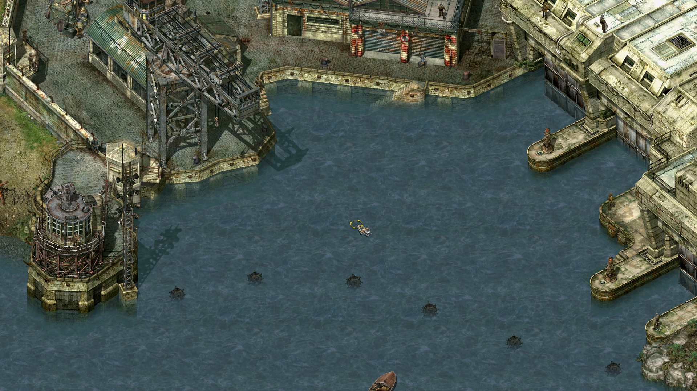
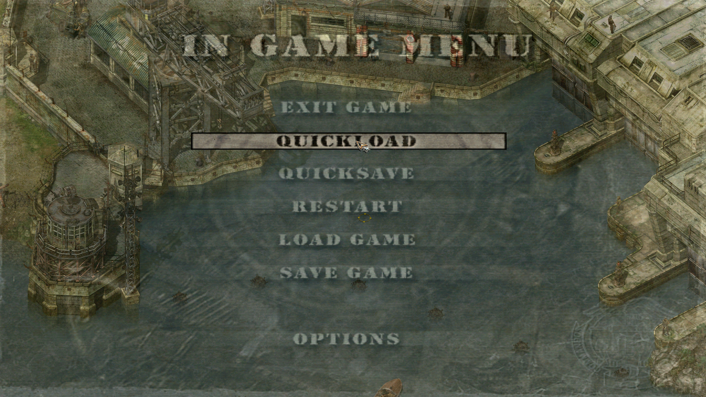

# Commandos2-ModernPatch

[](../../releases/latest)
[](../../releases)
[](LICENSE)

High frame rate, Full HD and bug-fix patch for **Commandos 2: Men of Courage** (Steam).

Commandos 2 runs its game logic and its rendering at a fixed 25 frames per second.
Commandos2-ModernPatch keeps the game logic at its original 25 ticks per second — so
game speed, AI and mission scripts are unchanged — but renders as many frames as your
monitor can show in between, moving the camera and everything on the map smoothly.
It also fixes several bugs of the original game at modern resolutions.

<!-- Comparison video: replace VIDEO_ID with the YouTube video id.
[](https://www.youtube.com/watch?v=VIDEO_ID)
-->

| Full HD mission (Das Boot, Silent Killer) | Full-screen pause menu over the game in HD |
|---|---|
|  |  |

## Features

**Smooth rendering**
- Rendering at your monitor's refresh rate (e.g. 144/240 Hz) while the game logic stays
  at 25 ticks per second: camera scrolling, zoom and rotation, soldiers, enemies,
  vehicles and projectiles move smoothly.
- Smooth rotation of building and vehicle interiors (Alt + middle mouse button) and of
  the window shown when peeking through a door.
- Smooth cursor, including dragging items in the inventory and the menus; the pick-up
  shine on bonus books plays at its original speed, drawn smoothly.
- Even frame pacing, also with a frame rate cap (`MaxFps`).

**Full HD**
- Full HD (or any) resolution for the game's HD video mode (originally 1280×720).
- Full-screen pause menu in HD: the menu is scaled up over a sharp view of the game.
- No black screens when the game switches resolution — borderless full screen through
  the bundled [cnc-ddraw](https://github.com/FunkyFr3sh/cnc-ddraw). Loading screens fill
  the screen.

**Fixes for bugs of the original game**
- Crash when zooming in at resolutions above 1280×720.
- Holes and smeared areas in the map when zoomed out at high resolutions.
- Quick repeated clicks in the inventory were ignored (picking up and dropping an item).
- The cheat password changed in the Steam version: both `PYROFOREVER` and the classic
  `GONZOANDJON` work, or enable cheats with `Cheats=1`.

**Performance**
- Faster rendering of water, and of the map while the camera is still.

Original behaviour is kept where smoothing is not possible: character animation frames,
the 3D portraits and the animated cursor run at their original speed. Everything can be
switched off in `Commandos2-ModernPatch.ini`, and toggled in game: **F10** — whole patch
on/off, **F11** — smooth movement of objects on/off.

No game files are modified; the patch is a `ddraw.dll` placed next to the game and
applies its changes in memory while the game runs.

## Requirements

- Commandos 2: Men of Courage, **Steam version**, the main executable `Comm2.exe`
  (SHA-256 `3645321656e05fab2cb91cff7d416152c9276d821ffef85cd0399bd4a15d1aaa`).
  The "Legacy" version (`Legacy\comm2.exe`) is not supported.
- Windows 10 or 11.

## Installation

1. Download `Commandos2-ModernPatch-<version>.zip` from the [Releases](../../releases) page.
2. Extract it into the game folder (the folder containing `Comm2.exe`, e.g.
   `C:\Program Files (x86)\Steam\steamapps\common\Commandos 2 Men of Courage`).
   You should end up with `ddraw.dll` and `Commandos2-ModernPatch.ini` next to
   `Comm2.exe`, plus a `Commandos2-ModernPatch` folder.
3. Start the game normally from Steam (not the Legacy version).
4. For Full HD: in the game's video options choose **1280x720 (16:9)** — the patch turns
   this mode into the resolution set in `HDResolution` (default 1920×1080). The label in
   the menu keeps saying 1280x720.

**Uninstall:** delete `ddraw.dll`, `Commandos2-ModernPatch.ini`, `Commandos2-ModernPatch.log`
and the `Commandos2-ModernPatch` folder.

## Configuration (`Commandos2-ModernPatch.ini`)

| Option | Default | Description |
|---|---|---|
| `Enabled` | 1 | 0 = the game behaves exactly like the original |
| `Camera` | 1 | Smooth camera scrolling and zoom |
| `Objects` | 1 | Smooth movement of soldiers, vehicles, projectiles (F11) |
| `Mouse` | 1 | Smooth cursor and inventory dragging |
| `Menus` | 1 | Smooth cursor in menus |
| `HDResolution` | 1920x1080 | Resolution of the game's HD video mode |
| `HDMenus` | 1 | Pause menu in the game resolution |
| `PauseMenuScale` | 1 | 1 = stretched to full screen, 2 = enlarged 4:3, 0 = small and centred |
| `CncDDraw` | 1 | 1 = borderless full screen via cnc-ddraw, 0 = system DirectDraw |
| `Cheats` | 0 | 1 = cheat keys always active (see below) |
| `Optimizations` | 1 | Faster rendering of water and of the map while the camera is still (0 = original code; not in the ini by default) |
| `MaxFps` | 0 | Frame rate cap, 0 = monitor refresh rate |
| `Debug` | 0 | 1 = statistics in `Commandos2-ModernPatch.log` |

cnc-ddraw's own settings are in `Commandos2-ModernPatch\cnc-ddraw\ddraw.ini` (section
`[comm2]`). **Alt+Enter** switches between full screen and a window.

## Cheats

The Steam version changed the cheat password from `GONZOANDJON` to `PYROFOREVER`, which
is why the old cheats seem not to work. The patch accepts both, in any letter case: type one
during a mission (single player), or set `Cheats=1` to skip the password. Cheat keys include
**Ctrl+I**, **Ctrl+V**, **Shift+X** (move the selected commando to the cursor) and
**Ctrl+Shift+N** (complete the mission).

## Known limitations

- Character animations (walking cycles etc.) are hand-drawn at the original frame rate;
  only their movement across the screen is smoothed.
- Mission briefings run in 640×480 (scaled) at the original 25 fps.
- Menus are 640×480 artwork and are shown with black bars (4:3).
- Camera and object positions are shown one logic tick (40 ms) behind; unit orders and
  game timing are not affected.
- Mainly tested at 1920×1080. At 4K or ultrawide resolutions the map can show missing
  areas when fully zoomed out; reports from such setups are welcome.

## Troubleshooting

First look at `Commandos2-ModernPatch.log` next to `Comm2.exe`. Every start adds a section
beginning with `=== hh:mm:ss ===` (the last one is the latest), which says whether the patch
recognised the game and which parts were enabled.

| Problem | What to try |
|---|---|
| Nothing changes, the log says `unexpected Comm2.exe build - hooks disabled` | The patch only works with the Steam `Comm2.exe` (see Requirements). The GOG and Legacy versions, and executables changed by other mods, are not supported. If Steam updated the game, please open an issue. |
| No log file at all | `ddraw.dll` is not being loaded: check that it is in the same folder as `Comm2.exe`, and that you start the main version from Steam, not "Legacy". Some antivirus programs block or quarantine proxy DLLs like `ddraw.dll`. |
| The game does not start, black screen or crash at start | Remove other DirectDraw / Direct3D wrappers from the game folder (HD Project files, ReShade `dxgi.dll` / `d3d9.dll`, dgVoodoo). Then try `CncDDraw=0`. Turn off overlays one by one (Steam, Discord, MSI Afterburner / RivaTuner, recording software). |
| Black or flickering picture, wrong colours | In `Commandos2-ModernPatch\cnc-ddraw\ddraw.ini`, section `[comm2]`, change `renderer=auto` to `renderer=opengl`, `renderer=direct3d9` or `renderer=gdi`. Update the graphics driver. |
| Stutter or low frame rate | Set `MaxFps` to your monitor refresh rate or lower (e.g. `MaxFps=60`). Check that the game runs on the dedicated graphics card on laptops. `Debug=1` writes frame statistics to the log. |
| Mouse cursor is offset or clicks hit the wrong place | Make sure the Windows display scaling is not overridden for `Comm2.exe` (Properties → Compatibility → Change high DPI settings), and try without other mods. |
| Something looks or behaves wrong only with the patch | Press **F10** to turn the patch off in game and compare. If it is only wrong with the patch, please open an issue. |
| Crash during the game | The log contains the crash address. Please open an issue and attach it. |

**Reporting a problem:** open an issue on the [Issues](../../issues) page with the
**Bug report** form and attach `Commandos2-ModernPatch.log`. For crashes or performance
problems set `Debug=1` first, reproduce the problem, then attach the log. Please also
include the resolution, monitor refresh rate and graphics card.

## Building from source

Requirements: Visual Studio 2019 or newer with *Desktop development with C++*.

```
build.bat                                             (builds build\ddraw.dll)
powershell -ExecutionPolicy Bypass -File package.ps1  (builds out\Commandos2-ModernPatch-<version>.zip)
```

`package.ps1` downloads cnc-ddraw 7.1.0.0 from its GitHub releases (checksum verified).
For development, copy `build\ddraw.dll` and `dist\Commandos2-ModernPatch.ini` into the game
folder and the cnc-ddraw files into `<game>\Commandos2-ModernPatch\cnc-ddraw\` (or set
`CncDDraw=0`).

How the patch works internally — hooks, addresses and the reasoning behind them — is
described in [docs/TECHNICAL.md](docs/TECHNICAL.md).

## License

MIT, see [LICENSE](LICENSE). Bundled cnc-ddraw: MIT, see [THIRD_PARTY.md](THIRD_PARTY.md).
Commandos 2 is a trademark of its respective owners; this project contains no game code
or assets and requires a legally owned copy of the game.
